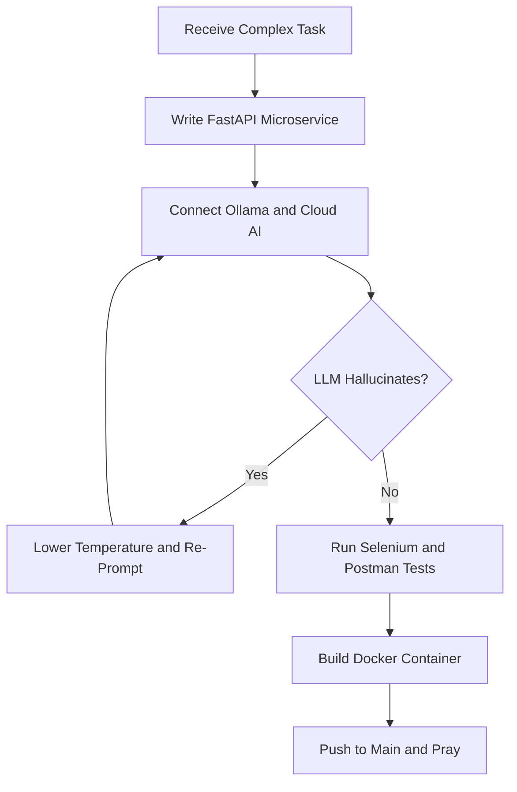

<p align="center"><b>Software Engineer | Applied AI &amp; Backend Engineering</b></p>

<p align="center">
  
</p>

<div align="center">
  <a href="https://github.com/DenverCoder1/readme-typing-svg">
    
  </a>
</div>

<br/>

## 👋 Who Am I?

<table>
<tr>
<td valign="middle">

```python
class Mustafa:
    def __init__(self):
        self.name = "Mustafa Abdulhammed"
        self.role = "Software Engineer | Applied AI & Backend"
        self.education = "B.Sc. Computer Science @ Cairo University (Math Dept. CS Single Major)"
        self.experience = "1+ year: fullstack, QA automation, DevOps"
        self.location = "Cairo, Egypt 🇪🇬"
        self.coffee = "Mandatory"
        self.status = "Training local LLMs while praying the Docker container stays alive"

    def current_mission(self):
        return "Plug agentic workflows straight into backend microservices, so humans stop repeating themselves."

    def currently_learning(self):
        return ["GCI World 2026 (AI & ML)", "DEPI DevOps Track", "Data Preprocessing"]
```

</td>
<td valign="middle" align="center" width="200">
  
</td>
</tr>
</table>


## 🩺 Current Mood

```sql
SELECT bug_description, panic_level
FROM system_logs
WHERE pipeline_status = 'FAILED'
  AND deployment_environment = 'Production';
```

**Result:**

```text
1 bug found: LLM hallucinated a non-existent C# method.
Severity: High
Solution: Prompting politely and lowering temperature to 0.1
```


## 🛠️ What I Actually Do

- 🤖 **Build AI agent workflows:** Async Python microservices (FastAPI + Pydantic + Ollama) that classify support tickets and route intent across multiple steps.
- ⚡ **Backend engineering:** ASP.NET Core REST APIs, EF Core, LINQ, and SQL Server stored procedures that actually run fast.
- 🧪 **Break things on purpose:** Selenium POM frameworks and Postman regression suites, because bugs are cheaper to find on my laptop than in production.
- 🐳 **Ship it:** Docker, Kubernetes, Terraform, and GitHub Actions, so "it works on my machine" retires for good.


## 📊 Numbers I'm Not Embarrassed By

| What                                   | Count          |
| -------------------------------------- | -------------- |
| Backend REST API endpoints built (ITI) | **20+**        |
| SQL Server stored procedures written   | **15+**        |
| Web test scenarios automated (DEPI)    | **50+**        |
| Postman-covered endpoints              | **30+**        |
| Faster regression cycles thanks to POM | **40%**        |
| Postman regression pass rate           | **100%**       |
| Cups of coffee                         | _Unmeasurable_ |


## 🧭 The Journey So Far

| When                   | Where                                      | What I did                                                                                                         |
| ---------------------- | ------------------------------------------ | ------------------------------------------------------------------------------------------------------------------ |
| **10/2023 → now**      | Cairo University, Faculty of Science       | B.Sc. Computer Science (Math & CS Dept.): ML, AI, Linear Algebra, DS&A, Computer Graphics, Databases               |
| **07/2025 → 09/2025**  | **ITI**, Full Stack .NET Developer Intern  | Built 20+ REST endpoints in C# / ASP.NET Core, designed normalized SQL Server schemas, wrote 15+ stored procedures |
| **09/2024 → 06/2025**  | **DEPI**, Software Testing Engineer Intern | Automated 50+ Selenium/TestNG scenarios, built Postman collections, ran the full STLC with SQL data verification   |
| **2026 (in progress)** | GCI World + DEPI DevOps Track              | AI & ML engineering, Linux, Docker, K8s, CI/CD, Terraform                                                          |


## 💻 Tech Stack

<p align="center"><b>🤖 AI &amp; Agents</b><br/>
  
  
  
  
  
  
  
</p>

<p align="center"><b>⚙️ Backend &amp; Databases</b><br/>
  
  
  
  
  
  
  
</p>

<p align="center"><b>🖥️ Frontend &amp; Languages</b><br/>
  
  
  
  
</p>

<p align="center"><b>🐳 DevOps</b><br/>
  
  
  
  
  
  
  
</p>

<p align="center"><b>🧪 Testing &amp; QA</b><br/>
  
  
  
  
  
</p>

**Skill status:**

```text
Python & AI Agents    ▓▓▓▓▓▓▓▓▓▓  Daily driver, still leveling up
C# & ASP.NET Core     ▓▓▓▓▓▓▓▓▓▓  Battle-tested
Automation & QA       ▓▓▓▓▓▓▓▓▓░  Battle-tested
SQL & Databases       ▓▓▓▓▓▓▓▓▓░  Stored procedures are my love language
Docker & DevOps       ▓▓▓▓▓▓▓▓░░  Currently in training (DEPI)
Googling Error Logs   ▓▓▓▓▓▓▓▓▓▓▓▓▓▓▓▓▓▓▓▓  Infinite
```


## 🤯 The AI Agent Workflow Life

<p align="center">
  
</p>

**Me:**

```text
"Please route this support ticket to the right microservice."
```

**Local LLM (Ollama):**

```text
"I have re-written your entire database schema in JSON."
```

**Me:**

```text
"Please stick to the Pydantic model..."
```


## 🔄 Daily Workflow




## 🚀 Featured Projects

### 🤖 AI Agent Workflows & Cloud Microservices _(in progress)_

`Python` `FastAPI` `Pydantic` `Scikit-Learn` `Ollama` `Lightning AI` `OmniRoute`

Async microservices that plug agentic workflows into the application core. Agents handle ticket classification and multi-step intent routing, multiple cloud AI providers sit behind one OmniRoute endpoint, and I'm prototyping agentic DevOps flows that read CI/CD builds and diagnose logs.

```text
Accuracy: High | Latency: Low | LLM Hallucinations: Managed
```

### 🚗 Motorak: Vehicle Services Platform _(ITI Capstone)_

`ASP.NET Core` `EF Core` `SQL Server`

Backend developer in a 4-intern team. Multi-layered Web API with 15+ optimized stored procedures for fast database transactions.

### 🎓 EduHub: Full-Stack Learning Platform

`React` `Node.js` `MongoDB` `Firebase`

Full-stack developer **and** GitHub Manager for a 6-student team: React UI, 10+ REST endpoints, MongoDB schemas, and keeping everyone's Git workflow from turning into a merge-conflict horror movie.

### 🧪 Automation Exercise: UI & API Test Automation

`Selenium` `TestNG` `Postman` `Java`

Page Object Model UI framework plus Postman regression suites covering 30+ endpoints, with a 100% pass rate.

### ⚔️ Knight Combat: 2D Game _(CS304 Computer Graphics)_

`Java` `JOGL (OpenGL)`

A 2D game built from the rendering pipeline up: scene management, input handling, 2D transformations, and texture mapping.


## 🌐 Connect With Me

<div align="center">
  <a href="mailto:abdulhammedmustafa@gmail.com" target="_blank">
    
  </a>
  <a href="https://github.com/Mustafa-Abdulhammed" target="_blank">
    
  </a>
</div>

<br/>

<div align="center">
  
</div>


