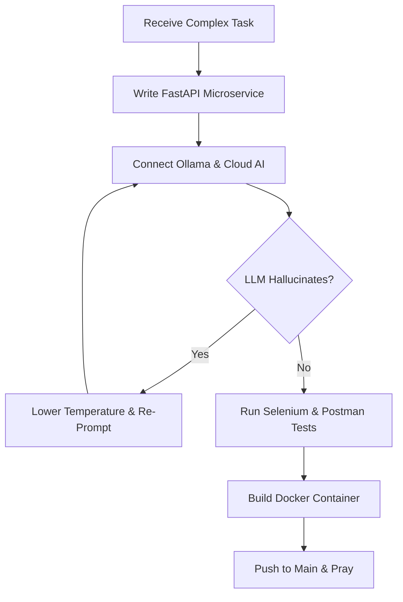

<div align="center">
  <a href="https://git.io/typing-svg">
    
  </a>
  
</div>


## Who Am I?

```python
class Mustafa:
    def __init__(self):
        self.name = "Mustafa Abdulhammed"
        self.role = "Software Engineer | Applied AI & Backend"
        self.education = "Computer Science & Math @ Cairo University"
        self.coffee = "Mandatory"
        self.status = "Training local LLMs while praying Docker container stays alive"

    def current_mission(self):
        return "Integrating agentic workflows into backend microservices to replace human repetition."
```

<div style="clear: both"></div>

---

## Current Mood

```sql
SELECT bug_description, panic_level
FROM system_logs
WHERE pipeline_status = 'FAILED' AND deployment_environment = 'Production';
```

**Result:**

```text
1 bug found: LLM hallucinated a non-existent C# method.
Severity: High
Solution: Prompting politely and lowering temperature to 0.1
```

---

## What I Actually Do

- 🤖 **Build AI Agent Workflows:** Async Python microservices with FastAPI & Ollama for dynamic ticket classification.
- ⚡ **Backend Engineering:** ASP.NET Core REST APIs, EF Core, and SQL Server stored procedures that execute efficiently.
- 🧪 **Automate Everything:** Selenium POM frameworks and Postman regression suites with a 100% test pass rate.
- 🐳 **DevOps Operations:** Containerizing pipelines with Docker, Kubernetes, and GitHub Actions so "it works on my machine" is never said.

---

## 💻 Tech Stack & Skills

<p align="center">
  
</p>

```text
Python & AI Agents    ████████████████████
C# & ASP.NET Core     ████████████████████
Automation & Testing  ██████████████████
Docker & DevOps       ████████████████
SQL & Databases       ██████████████████
Googling Error Logs   ████████████████████████████████████
```

---

## The AI Agent Workflow Life

<p align="center">
  
</p>

**Me:**

```text
"Please route this support ticket to the right microservice."
```

**Local LLM (Ollama):**

```text
"I have re-written your entire database schema in JSON."
```

**Me:**

```text
"Please stick to the Pydantic model..."
```

---

## 🔄 Daily Workflow



---

## 🚀 Featured Projects

### 🤖 AI Agent Workflows & Microservices
Asynchronous microservices engineered with **Python**, **FastAPI**, **Pydantic**, and **Ollama**. Automates support issue triage and agentic ticket classification.

```text
Accuracy: High | Latency: Low | LLM Hallucinations: Managed
```

### 🚗 Motorak - Vehicle Services Platform
Built ASP.NET Core Web APIs and authored 15+ optimized SQL Server stored procedures for lightning-fast database transactions.

---

## 🌐 Connect With Me

<div align="center">
  <a href="mailto:abdulhammedmustafa@gmail.com" target="_blank">
    
  </a>
  <a href="https://github.com/Mustafa-Abdulhammed" target="_blank">
    
  </a>
</div>

<div align="center">
  
</div>

